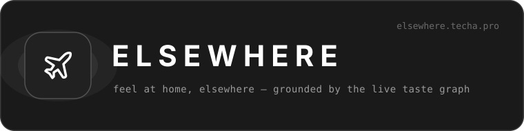
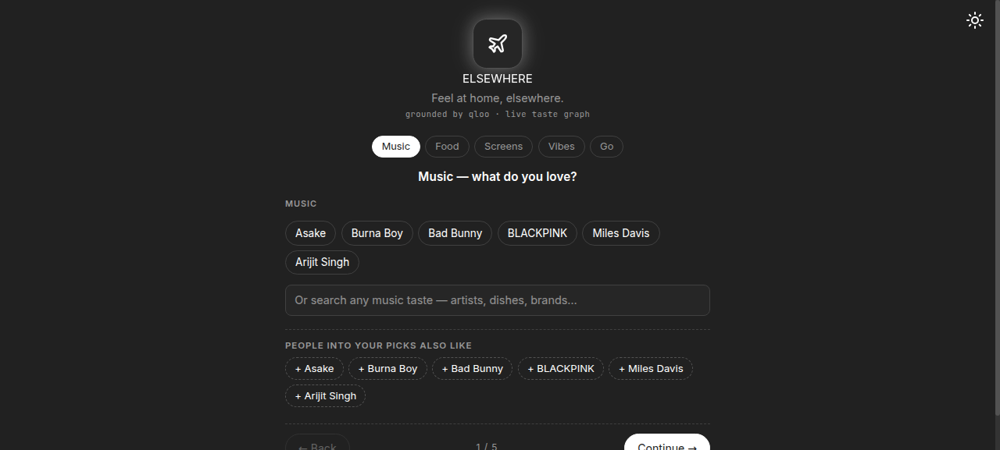
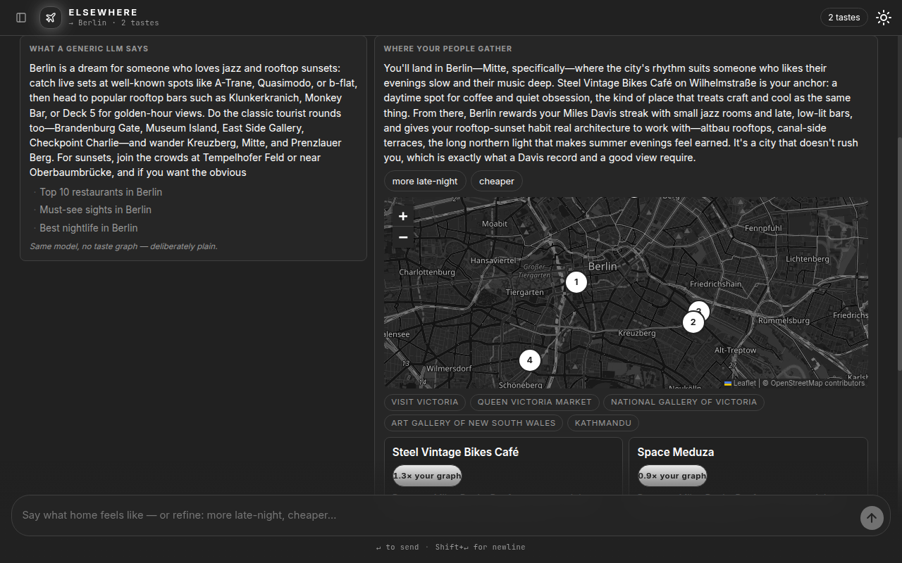

<div align="center">



<br />

<em>Type what home feels like + the city you just landed in. A generic LLM gives you
TripAdvisor. <strong>ELSEWHERE</strong> shows you where you'll belong: a map of spots in the
new city where people with overlapping taste actually gather — each with the reason
attached.</em>

<br />

<table>
  <tr>
    <td width="50%"></td>
    <td width="50%"></td>
  </tr>
  <tr>
    <td align="center"><sub>The wizard — search any taste, from any scene</sub></td>
    <td align="center"><sub>The side-by-side — generic list vs. where your people gather</sub></td>
  </tr>
</table>

<a href="https://elsewhere.techa.pro"><strong>elsewhere.techa.pro</strong></a> · built for the
<a href="https://qloo.devpost.com/">Qloo Agentic Hackathon</a>

</div>

## What this is

ELSEWHERE is a taste transplant app: tell it what home feels like and which city you just landed in, and it maps spots in the new city where people with overlapping taste gather — with the reason attached.

## Why

A generic model answers "where should I go in Lisbon?" with the same list for everyone. ELSEWHERE instead resolves your picks into real taste-graph entities (Qloo), fans out to correlated tastes, and renders the result as a literal side-by-side: *what a generic LLM says* next to *where your people gather* — a Leaflet map with pins, transplant cards with affinity badges, and the taste path connecting your picks to each spot.

## Quickstart

Prerequisites: [Docker](https://docs.docker.com/get-docker/) with Compose v2, plus Python 3.11 and Node 20 if you want to run the tests or the frontend outside Docker.

```bash
git clone https://github.com/techafreshh/elsewhere.git && cd elsewhere
cp .env.example .env
docker compose up --build
```

No keys needed: with an empty `.env` the stack runs in mock mode against committed fixtures. `.env` is gitignored and stays untracked.

Check it is up (host port `8000`):

```bash
curl localhost:8000/api/health
# {"status":"ok","mode":"mock","qloo":true,"model":true}

curl localhost:8000/
# the SPA index.html (expect ELSEWHERE in <title>)
```

Open [http://localhost:8000](http://localhost:8000) in a browser.

Run the backend test suite:

```bash
python -m pytest backend/tests -q
```

> [!NOTE]
> `mode` in the health response is read at call time: `mock` without `QLOO_API_KEY`, `live` with it. `qloo` and `model` are static capability flags, not live checks — health makes no outbound calls.

### Frontend-only development

The Compose image already serves the committed `frontend/dist` SPA. To iterate on the UI with hot reload:

```bash
cd frontend && npm ci && npm run dev
```

`npm run build` regenerates `dist/`, which the API serves at `/` via the `StaticFiles` mount (`DIST_DIR` in `backend/app/main.py`). The API still runs separately in that setup:

```bash
uvicorn backend.app.main:app --host 0.0.0.0 --port 8000
```

Available frontend scripts (`frontend/package.json`): `dev` (Vite dev server), `build` (`tsc -b && vite build`), `preview`.

## Usage

1. **Onboarding wizard** — pick tastes across four categories (Music, Food, Screens, Vibes) from 24 pre-resolved chips, or type anything into each section's search box: `GET /api/search_tastes?q=` resolves free text into real graph entities (minimum 2 characters). A "people into your picks also like" row (`POST /api/related`) updates with every selection, and the last step takes any city on earth — a 169-city dictionary answers instantly, `GET /api/geocode?name=` covers the rest.
2. **Chat comparison** — the transplant agent streams over `POST /agui` (AG-UI SSE via `iter_transplant_events` in `backend/app/agui.py`), then renders the side-by-side: generic answer on the left, taste-grounded map + cards on the right.
3. **Refinement pills** ("more late-night", "cheaper") re-run the transplant in place with `refinements`; the transcript keeps a short trail of replaced asks.

Your selections, city, and last result persist in the browser's localStorage (`elsewhere.taste.v1` + `elsewhere.session.v1`, see `frontend/src/taste.ts`). To start fresh, clear both keys in DevTools (Application → Local Storage) or use the chip tray's Clear button.

Direct API use (JSON fallback, no SSE):

```bash
curl -X POST localhost:8000/api/transplant \
  -H 'Content-Type: application/json' \
  -d '{"seeds": ["Asake", "Late-night ramen"], "dest_city": "Lisbon"}'
```

Repeat queries answer instantly: transplant results are cached server-side, keyed by seeds + city + refinements (`backend/app/cache.py`).

Endpoints:

| Method | Path | Purpose |
| --- | --- | --- |
| `POST` | `/agui` | Transplant agent stream (SSE, never cached) |
| `POST` | `/api/transplant` | Transplant result as JSON (cache-first) |
| `GET` | `/api/catalog` | Chip catalog + city dictionary from disk |
| `GET` | `/api/search_tastes?q=` | Free text → taste entities (`q` ≥ 2 chars) |
| `POST` | `/api/related` | Correlated tastes for selected entity ids |
| `GET` | `/api/geocode?name=` | Typed city → coordinates (`name` ≥ 2 chars) |
| `GET` | `/api/health` | Liveness probe (`status`/`mode`/`qloo`/`model`) |

## Configuration

All variables are optional and read at call time (no restart needed to pick up a key change). Copy source: `.env.example`.

| Variable | Default | Effect |
| --- | --- | --- |
| `QLOO_API_KEY` | unset (mock mode) | Without it, Qloo calls resolve against committed synthetic fixtures. With it, the same code paths (`backend/app/qloo.py`) go live. |
| `OPENROUTER_API_KEY` | unset (template copy) | Without it, summaries fall back to built-in template copy. With it, `backend/app/summarizer.py` calls OpenRouter for live summaries. |
| `OPENROUTER_MODEL` | `deepseek/deepseek-v4.1-flash` | Model slug used by the agent and summarizer (`MODEL_SLUG` / `DEFAULT_MODEL`). |
| `OPENROUTER_TIMEOUT` | `15` (agent) / `30` (summarizer), seconds | Per-call OpenRouter HTTP timeout. Not present in `.env.example` — add it by hand if you need it. |

> [!IMPORTANT]
> Real keys live only in the gitignored `.env`. Never commit them; `.dockerignore` and `.gitignore` both deny `.env*` (except `.env.example`) and the server cache directory.

## How it works

Free-text seeds resolve via one Qloo search each into `confirmations`; chip picks pass through with zero latency (`resolve_seeds` in `backend/app/agent.py`). The agent then fans out to taste insights and places, builds tourist/transplant summaries (live model or template copy), and returns the envelope the frontend renders: map center + pins, cards with affinity badges, brands, notices, and `meta` (`model`, `cache_hit`, `qloo_mode`). `POST /agui` streams the same loop as server-sent events; `POST /api/transplant` returns it as one JSON payload.

## Architecture

```text
backend/app/      FastAPI service (single image, serves API + SPA on :8000)
  main.py         routes + StaticFiles mount of frontend/dist
  agent.py        transplant loop (resolve → insights → payload)
  agui.py         SSE event stream for POST /agui
  qloo.py         taste-graph client (live key or mock fixtures)
  summarizer.py   OpenRouter summaries (template fallback without key)
  cache.py        server-side transplant cache (seeds + city + refinements)
  catalog.py      chips + cities served from backend/data/*.json
  data/           chips.json (24 chips) + cities.json (169 cities)
frontend/src/     React 19 + Vite + Tailwind UI
  App.tsx         wizard + side-by-side chat workspace
  TransplantMap.tsx  Leaflet map (OSM tiles, per-pin markers)
  components/motion/ vendored beUI motion components (no beUI npm package)
  taste.ts        localStorage keys elsewhere.taste.v1 / elsewhere.session.v1
docker-compose.yml   local stack: api (8000:8000) + caddy (:80 → api:8000)
compose.prod.yaml     production stack: external web_gateway network, no host
                     ports, warmed cache volume, /api/health healthcheck
Caddyfile            local reverse proxy (:80 → api:8000)
```

> [!TIP]
> `docker-compose.yml` is the portable local-dev stack. `compose.prod.yaml` is the VPS deployment variant (see its header comment) — same image, different networking.

## Limitations / roadmap

- Mock mode fixtures are synthetic and static: mock search only returns fixture hits whose names match the query, so unrelated prefixes yield few or no results.
- The generic side of the comparison is written by the same configured model with zero taste-graph data — it is a deliberate illustration, not an independent baseline.
- `qloo`/`model` in `/api/health` are static `true` flags, not dependency checks.
- Refinement filters are a small fixed vocabulary (e.g. late-night, cheap); unknown strings are kept in the cache key but change little.
- Production hosting specifics (`compose.prod.yaml`, `Caddyfile` TLS) are environment-dependent and verified only against local Compose plus CI (`docker compose config`, `test -f Caddyfile`, frontend `npm run build` + `test -f dist/index.html`).

---

Licensed under [MIT](LICENSE).
