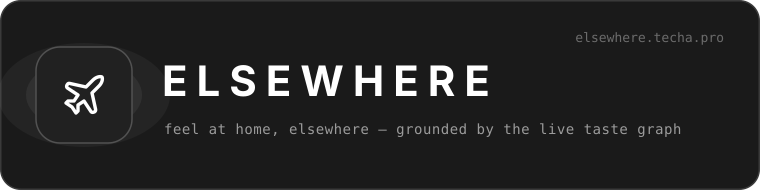
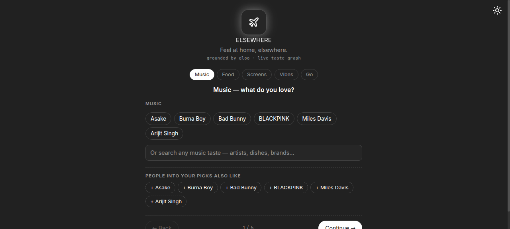
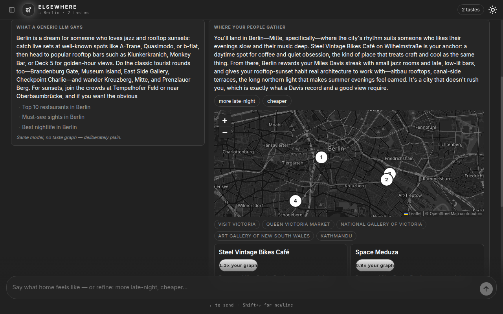

 

<em>Type what home feels like + the city you just landed in. A generic LLM gives you
TripAdvisor. <strong>ELSEWHERE</strong> shows you where you'll belong: a map of spots in the
new city where people with overlapping taste actually gather — each with the reason
attached.</em>

 

<table>
  <tr>
    <td width="50%"></td>
    <td width="50%"></td>
  </tr>
  <tr>
    <td align="center">The wizard — search any taste, from any scene</td>
    <td align="center">The side-by-side — generic list vs. where your people gather</td>
  </tr>
</table>

<a href="https://elsewhere.techa.pro"><strong>elsewhere.techa.pro</strong></a> · built for the
<a href="https://qloo.devpost.com/">Qloo Agentic Hackathon</a>

## How it works

Two screens, one agent:

- **Onboarding** — a centered, one-section-at-a-time wizard (Music → Food → Screens → Vibes → go): each section has its own chips **and its own "search any taste" box** that resolves any free text into real graph entities for that category, with a "people into your picks also like" row of correlated suggestions updating live on every selection. The last step takes **any city on earth** — a 169-city world dictionary answers instantly and the taste graph geocodes anything beyond it — plus an optional description of home.
- **Chat** — a beUI agent-chat workspace where the transplant agent runs live over AG-UI 1.0 SSE, then answers with a literal **side-by-side comparison**: *What a generic LLM says* on the left — **streamed live from a real model with zero taste-graph data** — and *Where your people gather* on the right: a Leaflet map with real pins, 5 transplant cards with affinity badges ("2.4× your graph"), and the taste path connecting *this you* → *this spot*. Stacks vertically on mobile. Refinement pills ("more late-night", "cheaper") re-run **the one result in place** — the transcript stays a short story, with the asks it replaced parked in a small trail.
- **Why this beats a list** — a disclosure under the comparison shows the cross-domain taste path and the actual query the generic side had no access to. The honesty toggle names the same model writing both sides.

Onyx deep-dark monochrome — dark by default, grayscale light mode via the toggle — wearing a VoltChat-style chat: Inter + JetBrains Mono, glowing logo tile, collapsible session sidebar (new transplant, your picks, start over), a centered transcript with right-aligned asks, tool-trace rows, and a glass composer with a mono hint row. Fully responsive. Your session (selections, city, result) persists in localStorage — reload lands you back in the chat, and "← Back to chat" from onboarding keeps both directions open.

## Status

🟢 **Live** — [elsewhere.techa.pro](https://elsewhere.techa.pro)

Architecture: FastAPI (AG-UI 1.0 agent endpoint + taste-graph proxy) · React + Vite (beUI `chat-app` component kit + deep-dark token CSS + Leaflet) · OpenRouter. See [`.agents/PRDs/PRD.md`](.agents/PRDs/PRD.md) for the full product spec.

## Setup

1. Clone the repo: `git clone <repo-url> && cd elsewhere`
2. Copy env: `cp .env.example .env` (mock mode needs no keys; `.env` stays untracked)
3. Start the stack: `docker compose up --build`
4. Check the API: `curl localhost:8000/api/health` (expect `status ok`, `mode mock`)
5. Check the SPA: `curl localhost:8000/` (expect `ELSEWHERE`)
6. Run the tests: `python -m pytest backend/tests -q`

**Notes**

- Your selection + live session (tastes, city, last result) **persist in your browser's localStorage** (`elsewhere.taste.v1` + `elsewhere.session.v1`) and a reload restores the chat. To start fresh, clear both keys in DevTools (Application → Local Storage) or tap the chip tray's Clear button.
- Every transplant result is cached server-side (keyed by seeds + city + refinements), so a repeat query answers instantly.
- No keys? Everything runs in **mock mode** against committed synthetic fixtures. With `QLOO_API_KEY` in `.env`, the same code paths go live; chip IDs are real, verified graph entities plus steering tag IDs (resolved once via `backend/scripts/resolve_chips.py`, operator-run with the key).
- Endpoints: `POST /agui` (SSE), `POST /api/transplant` (JSON fallback), `GET /api/catalog`, `GET /api/search_tastes?q=`, `POST /api/related`, `GET /api/geocode?name=`, `GET /api/health`.

## License

[MIT](LICENSE)
